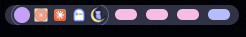

# noctalia-plugins

These are plugins I built for my own [Noctalia](https://noctalia.dev) v5
setup, written with the help of AI tooling. There are two: a niri
workspace/taskbar widget, and a thin Claude prompt bar that hands off to
Claude Desktop. I use both daily and share them here in case they help you
too.

## Table of Contents

- [Plugins](#plugins)
  - [niri-taskbar](#niri-taskbar)
  - [claude-launcher](#claude-launcher)
- [Host Requirements](#host-requirements)
- [Install](#install)
- [Development](#development)
- [Credits](#credits)
- [License \& Disclaimer](#license--disclaimer)

## Plugins

### niri-taskbar

A bar widget that combines niri workspaces and a taskbar. Stretchable idle
chips expand on hover into a pill of real app-icon window tiles.



**[Full README](./niri-taskbar)**

### claude-launcher

A one-row prompt bar with model and effort pickers. It runs the first turn
through your own `claude` CLI login, then opens the session in Claude
Desktop and focuses its window.


**[Full README](./claude-launcher)**

## Host Requirements

Neither plugin needs a patched Noctalia anymore. Every host capability
they use has merged upstream:

- claude-launcher: input submit-on-Enter merged on 2026-07-30 as plugin
  API 21 ([#3327](https://github.com/noctalia-dev/noctalia/pull/3327)).
- niri-taskbar: container `onClick`/`onHover` merged on 2026-07-21
  ([#3470](https://github.com/noctalia-dev/noctalia/pull/3470)).

Both plugins have moved on since then, and both refuse to load on older
builds. claude-launcher declares `plugin_api = 27` (`frameVisible` on
inputs). niri-taskbar declares `plugin_api = 34` (the bar hover tint
opt-out, Noctalia v5.3.0).

## Install

**As a plugin source.** Noctalia clones and manages the repo itself; you
need no local checkout.

```sh
noctalia msg plugins source add gegnep-plugins git https://github.com/gegnep/noctalia-plugins
noctalia msg plugins enable gegnep/claude-launcher
noctalia msg plugins enable gegnep/niri-taskbar
```

**Symlink a single plugin** into Noctalia's local plugin directory. Use
this for local development, or if you'd rather manage the checkout
yourself.

```sh
git clone https://github.com/gegnep/noctalia-plugins
cd noctalia-plugins
ln -sfn "$PWD/claude-launcher" ~/.local/share/noctalia/plugins/claude-launcher
ln -sfn "$PWD/niri-taskbar" ~/.local/share/noctalia/plugins/niri-taskbar
```

## Development

```sh
nix develop   # or let direnv load it automatically
```

The devshell provides `luau`, `jq`, `fd`, `ripgrep`, and `python3`:
everything each plugin's fixture harness and the catalog generator need. No
running Noctalia instance is required.

```sh
noctalia plugins lint   # lint all plugin manifests and Luau sources
```

Each plugin has its own offline fixture harness; see the plugin's README
for what it covers. Run both from the repository root:

```sh
./claude-launcher/fixtures/dry-run.sh
./niri-taskbar/fixtures/dry-run.sh
```

`catalog.toml` is required for consuming this repo as a git plugin source.
`python3 tools/update-catalog.py` generates it from `*/plugin.toml` (CI
also runs this on push to `main`). Don't edit it by hand.

## Credits

Built on [Noctalia](https://noctalia.dev) by the
[noctalia-dev](https://github.com/noctalia-dev) team.

## License & Disclaimer

[MIT](./LICENSE).
