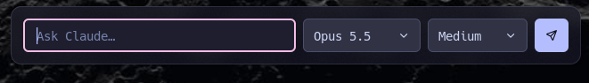
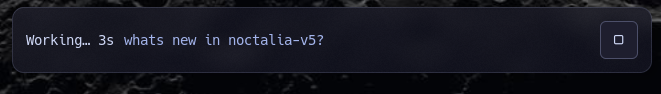

# claude-launcher

A thin prompt bar for [Claude](https://claude.com). Type a prompt, pick a
model and effort, and press Enter. The plugin runs the first turn through
your own `claude` CLI (Claude Code), then opens that session in Claude
Desktop and focuses its window. Usage bills against your Pro/Max
subscription; the plugin never talks to the Anthropic API directly and
never holds an API key.



*Not affiliated with, endorsed by, or sponsored by Anthropic. Claude is a
trademark of Anthropic PBC.*

## Table of Contents

- [Features](#features)
- [Requirements](#requirements)
- [Install](#install)
- [Usage](#usage)
- [Settings](#settings)
- [Notes and Limitations](#notes-and-limitations)
- [Development](#development)
- [License](#license)

## Features

- A one-row prompt bar: a single-line input, a model dropdown and an effort
  dropdown
- The first turn runs through `claude -p` with a fixed session id, with a
  live status line ("Thinking", "Writing", "Working") and elapsed seconds
- When the first reply is done, the session opens in Claude Desktop through
  `claude://resume?session=<id>`, with the model you picked
- The session is titled with the prompt, cut to 60 bytes, so Desktop's
  sidebar shows it even before you continue the session there
- On niri, the personal Claude Desktop window takes focus once it appears,
  including after a cold start
- Stop discards the turn and puts the prompt back in the input
- Errors show inline and keep the prompt, so Enter retries. A login error
  offers a terminal for a one-time `/login`; a failed handoff offers to
  continue the session in a terminal

## Requirements

- A Noctalia v5 build with plugin API 27 or newer. Older hosts refuse to
  load the plugin.
- The `claude` CLI (Claude Code), logged into a Pro/Max subscription.
- Claude Desktop, registered as the `claude://` handler. Check with
  `xdg-mime query default x-scheme-handler/claude`.
- `claude_command` and Claude Desktop must use the same
  `CLAUDE_CONFIG_DIR`. Desktop imports the session from that directory, so
  a CLI with a different config directory writes a session Desktop cannot
  find.
- `xdg-open`. Portal mode is recommended (`NIXOS_XDG_OPEN_USE_PORTAL=1` on
  NixOS); see Notes and Limitations.
- niri, for the focus step. On other compositors everything else works and
  you switch to Desktop yourself.

## Install

**As a plugin source.** Noctalia clones and manages the repo itself; you
need no local checkout.

```sh
noctalia msg plugins source add gegnep-plugins git https://github.com/gegnep/noctalia-plugins
noctalia msg plugins enable gegnep/claude-launcher
```

**Symlink** into Noctalia's local plugin directory. Use this for local
development, or if you'd rather manage the checkout yourself.

```sh
git clone https://github.com/gegnep/noctalia-plugins
cd noctalia-plugins
ln -sfn "$PWD/claude-launcher" ~/.local/share/noctalia/plugins/claude-launcher
```

## Usage

Bind a key to toggle the panel via IPC:

```sh
noctalia msg panel-toggle gegnep/claude-launcher:chat
```

The input has focus when the bar opens. Type a prompt and press Enter or
the send button. A draft survives closing and reopening the bar. The
dropdowns remember your last choice until Noctalia restarts; the settings
pick what they start on.

While the turn runs, the bar shows its status, the prompt and a Stop
button. You can close the bar; the handoff still happens when the turn
ends. Stop discards the turn and puts the prompt back.



| Key | Action |
|---|---|
| Enter | Send |

## Settings

| Key | Type | Default | Description |
|---|---|---|---|
| `claude_command` | string | `claude` | Path or name of the claude binary. It must use the same `CLAUDE_CONFIG_DIR` as Claude Desktop |
| `folder` | folder | *(empty)* | Folder the session runs in. Empty uses `$XDG_STATE_HOME/noctalia-claude-launcher/workspace` (`~/.local/state/...` when unset). Desktop trusts this folder when it opens the session |
| `model` | select | `auto` (first in list) | Model the picker starts on: `auto`, `claude-fable-5-1`, `claude-opus-5-5`, `claude-sonnet-5-5`, `claude-haiku-5-5` |
| `models` | string_list | `["claude-fable-5-1", "claude-opus-5-5", "claude-sonnet-5-5", "claude-haiku-5-5"]` | Model ids the picker offers, in order. Ids it does not know show as the raw id |
| `effort` | select | `auto` (High) | Effort the picker starts on: `auto`, `low`, `medium`, `high`, `xhigh`, `max` |
| `allow_tools` | bool | `true` | On: the first turn uses claude's normal tools and permission mode. Off: every tool is disabled |

## Notes and Limitations

- The first turn runs unattended. Permission prompts cannot show, so a tool
  that needs approval is refused on that turn. Continue in Desktop to
  approve it.
- Desktop opens only after the first reply is complete.
- Effort applies to the first turn only. Desktop's import carries the model
  and permission mode from the session, not the effort.
- `claude --desktop` refuses to run on Linux, so the plugin calls
  `xdg-open` with the resume link itself.
- The bar size is fixed in the manifest (640 × 66). The host has no
  percentage size and no runtime resize for plugin panels.
- The dropdowns are the host's standard select. Their look cannot be
  styled further from a plugin.
- An error shows one line in the bar. The full text, including the CLI's
  stderr, goes to the Noctalia log.
- Run `xdg-open` in portal mode. Noctalia gives it 10 seconds, and a
  timeout kills its whole process group. Without the portal, that group
  can include a Claude Desktop that `xdg-open` was starting.
- 0.2.0 replaced the chat panel. On load it deletes the old chat history
  files `index.json` and `last-session` from its state directory. It
  never touches the workspace folder.

## Development

```sh
nix develop   # or let direnv load it automatically
```

The devshell provides `luau`, `jq`, `fd`, `ripgrep` and `python3`. No
running Noctalia instance is required.

Lint the manifest and Luau sources:

```sh
noctalia plugins lint claude-launcher
```

Run the fixture harness:

```sh
./claude-launcher/fixtures/dry-run.sh
```

It ends with three OK lines: two replay real `claude --output-format
stream-json` captures (with and without `--include-partial-messages`)
through the parser and the Desktop handoff, and one drives the UI tree and
the turn state machine. See
[`fixtures/parser-spec.md`](./fixtures/parser-spec.md) for the parser
contract.

Check that every settings label in `plugin.toml` has a string in
`translations/en.json` (prints nothing when they match):

```sh
rg -o 'settings\.[a-z0-9_.]+' claude-launcher/plugin.toml | sort -u > /tmp/toml-keys
jq -r 'paths(scalars) | map(tostring) | join(".")' claude-launcher/translations/en.json | sort -u > /tmp/json-keys
diff /tmp/toml-keys /tmp/json-keys
```

Everything lives in a single `panel.luau` file, with no separate service.

## License

[MIT](../LICENSE).
